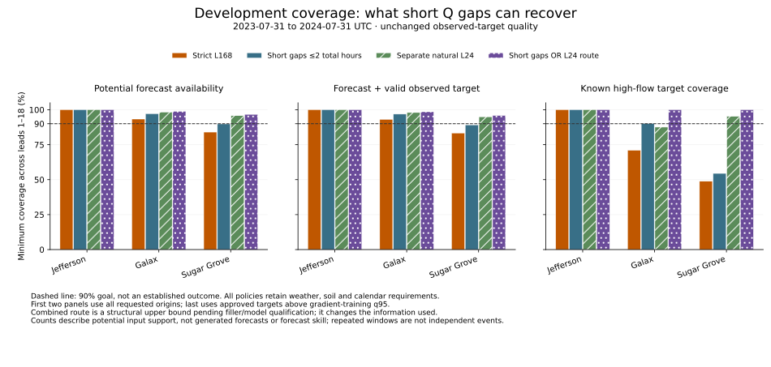

# Coverage sensitivity: census and decision packet

The user requested this census before changing models or freezing the protocol. The strict matched L168 primary and confirmed 180-fit matrix remain unchanged. All results below describe structural input support in development data; no values were imputed, forecasts generated, models fitted, or protected assessment data accessed. The 90% goal remains an aspiration, not an accuracy or operational-reliability claim.

## Main finding

Conservative one/two-hour Q handling alone cannot meet the goal at all three sites. A separate short-gap-or-L24 routing calculation has structural support above 90% on all three reported validation metrics at each site, including every lead. This makes a combined sensitivity worth investigating; it does not qualify either filler or demonstrate acceptable forecast errors. Longer L168 gaps remain excluded from short-gap repair; the L24 branch deliberately uses a different information window.

## Denominators and unchanged primary

For each gauge and lead, let I mean all required inputs are structurally supported and T mean the exact target has approved A or A+R quality. Forecast availability is count(I)/requested origins. Evaluable coverage is count(I and T)/requested origins; the additional conditional fraction count(I and T)/count(T) is also reported. Known-high-flow coverage uses only approved targets above a q95 threshold fitted to unique gradient-training reference hours. Missing/rejected targets stay in the all-origin denominator, never receive a flow regime and are never filled.

The original primary additionally requires all 18 targets to be valid. It still contains 146,464 complete development gauge/origin cases. The census covers 159,084 candidate cases, with the original 36 H18-boundary-purged origins per gauge kept separate. Across training plus validation, combined two-hour handling could support 3,939 additional complete-H18 cases; these are candidate sensitivity cases, not changes to training membership.

## Development validation, 2023-07-31 through 2024-07-31

Each gauge has 8,766 requested origins after target-boundary purging. Rates below are the **minimum across leads 1–18**, rather than a pooled percentage that could hide a weak lead. Full per-lead counts and rates are in the linked JSON reports.

| Gauge | Input policy | Potential forecast availability | Evaluable / all origins | Evaluable / valid targets | Known-high-flow coverage |
|---|---|---:|---:|---:|---:|
| Jefferson | Strict L168 | 100.00% | 100.00% | 100.00% | 100.00% |
| Jefferson | Short gaps ≤2h total | 100.00% | 100.00% | 100.00% | 100.00% |
| Jefferson | Natural L24 | 100.00% | 100.00% | 100.00% | 100.00% |
| Jefferson | Short gaps or L24 route | 100.00% | 100.00% | 100.00% | 100.00% |
| Galax | Strict L168 | 93.33% | 93.08% | 93.98% | 70.98% |
| Galax | Short gaps ≤2h total | 97.16% | 96.89% | 97.82% | 90.16% |
| Galax | Natural L24 | 98.25% | 98.00% | 98.95% | 87.56% |
| Galax | Short gaps or L24 route | 98.83% | 98.55% | 99.50% | 100.00% |
| Sugar Grove | Strict L168 | 84.02% | 83.32% | 84.77% | 48.81% |
| Sugar Grove | Short gaps ≤2h total | 89.84% | 89.14% | 90.69% | 54.46% |
| Sugar Grove | Natural L24 | 95.73% | 94.93% | 96.59% | 95.24% |
| Sugar Grove | Short gaps or L24 route | 96.67% | 95.87% | 97.54% | 100.00% |

These per-lead rates differ from the earlier 69.2%/50.0% Galax/Sugar Grove high-flow figures, which pooled repeated target cells after requiring complete H18 labels. Both are retained, with distinct denominators. The new census never uses partial targets to redefine the strict primary.

## Unique hours and observed peaks

Known-high-flow target observations deduplicate to 192 hours at Jefferson, 193 at Galax and 336 at Sugar Grove. The fixed event rule selects approved q95-exceeding maxima at least 168h apart, with nonoverlapping peak−48h to peak+72h diagnostic windows. It yields 9, 6 and 11 defined episodes. These are not proven independent floods, and simultaneous events across gauges are not independent replications. No peak is inferred inside unknown references. Annual coverage above 90% does not establish 90% in every season, event window or travel/operational condition.

| Gauge | Policy | Unique known-high hours supported at any lead | Observed peaks supported at every lead |
|---|---|---:|---:|
| Jefferson | Strict L168 | 192/192 | 9/9 |
| Jefferson | Short gaps ≤2h total | 192/192 | 9/9 |
| Jefferson | Natural L24 | 192/192 | 9/9 |
| Jefferson | Short gaps or L24 route | 192/192 | 9/9 |
| Galax | Strict L168 | 154/193 | 4/6 |
| Galax | Short gaps ≤2h total | 174/193 | 5/6 |
| Galax | Natural L24 | 186/193 | 5/6 |
| Galax | Short gaps or L24 route | 193/193 | 6/6 |
| Sugar Grove | Strict L168 | 172/336 | 7/11 |
| Sugar Grove | Short gaps ≤2h total | 188/336 | 7/11 |
| Sugar Grove | Natural L24 | 333/336 | 11/11 |
| Sugar Grove | Short gaps or L24 route | 336/336 | 11/11 |

An any-lead unique-hour count can be high while some leads remain unsupported. Per-lead event support, boundary scheduling flags, reference gaps and unsupported peaks remain in the event-detail files. The union route structurally covers all cataloged peaks and known-high hours in this development year; that is not peak-forecast accuracy or evidence about unobserved peaks.

## Why cases are missing and what can be recovered

In validation, every selected weather/soil/calendar input is available. The input blockers are Q history: 585 Galax and 1,401 Sugar Grove origins; Jefferson has none. Sugar Grove includes rejected estimated inputs as well as absent exact-hour readings. Quality rules remain unchanged: any later fill would be a derived input with original missingness and qualifiers preserved, never an approved observation. Across the full development corpus, non-Q blockers also exist and stay in the census; the perfect-Q diagnostic ceiling retains them. The committed selector requires a complete single H18 weather cycle, so jointly missing weather masks do not identify individual raw-variable failure causes.

The census records missing runs by position (leading/interior/trailing), duration, age within the L168 window, latest real-reading age, input-failure combination, season and policy. Run counts are overlapping history-window appearances, not distinct outages. Leading and long gaps remain excluded from short-gap L168 repair. Interior interpolation needs two approved endpoints available by the simulated cutoff; trailing candidates need the last approved real reading. The archive does not verify historical delivery/revision times, so the existing two-hour delay remains a simulation.

The conservative candidates cap both each run and **total filled hours** at one or two. Removing only the total cap adds no validation candidates at any gauge; the Sugar Grove validation shortfall is not caused by this extra conservatism. It would add candidate history windows in Galax training, which are separately reported as a nonadopted optimistic ceiling. No such relaxed policy is recommended here.

Trailing carry-forward and learned fallback share a structural mask ceiling, but a learned fallback needs additional lag context and can fail. Therefore the census cannot promise identical realized coverage for those methods. No rule is transferred to rainfall, weather or soil.

## Proposed next experiment and costs

See [the detailed methods proposal](coverage-sensitivity-design.md). A bounded CV1 pilot proposes six additional neural fits (three gauges × clean-H4 versus block-augmented H4, seed 17) plus three fixed ridge input-fallback fits. Both neural arms use the same observed/filled and elapsed-since-real schema, sources, target cases, transformations and training opportunities. Paired artificial gaps in originally observed history test interpolation, trailing carry versus ridge, and mixed gaps; clean inputs, ordinary/rising/high-flow strata, false alarms and defined peaks remain visible. Recovered real-gap forecasts are a separate population.

An optional final-development confirmation adds 18 neural and three ridge fits. Both stages total 24 neural plus six ancillary fits, all currently unapproved. Measured old-H2 throughput gives about 2.62 hours at 20 epochs or 6.24 hours at 50 epochs for both stages including extra artificial-gap inference passes. These are proxies: H4, gap construction, ridge, scoring/resampling and execution overhead still require qualification and timing. Explicit 1×/1.5×/2× scenarios are estimates, not confidence bounds.

The existing 180-fit plan already includes final-development L24 models, so a final-only L24 routing branch needs no additional neural fits beyond those planned; it still needs inference and routing qualification. No L24 CV1 checkpoint is included in that primary plan. The combined routing census is therefore a final-development contingency, not a free, already implemented pilot arm. The approved $150 ceiling is unchanged and no paid job is started.

Before any expansion, review the pilot scope, acceptable clean-input degradation and failure tolerances, artificial-gap distribution, and whether the final-only combined route should be included. If approved, freeze a pilot-specific protocol and qualify implementations first; the main protocol remains unfrozen until those scientific tradeoffs are resolved. Protected assessment stays outside policy selection and separately gated.

## Reproducible evidence

- [Main census and all per-lead rates](../reports/development-gap-recovery-v1.json).
- [Separate combined-routing census](../reports/development-gap-routing-v1.json).
- [Jefferson events](../reports/development-gap-recovery-v1-events-03161000.json), [Galax events](../reports/development-gap-recovery-v1-events-03164000.json), [Sugar Grove events](../reports/development-gap-recovery-v1-events-03479000.json).
- [Resource proposal and arithmetic](../reports/coverage-sensitivity-resource-proposal.json).
- `audit_gap_recovery.py` reproduces the full census; `audit_gap_route.py` independently reconstructs and crosschecks the baseline/short/L24 counts before computing the union. Both use pinned resident development inputs and leave data unchanged.
