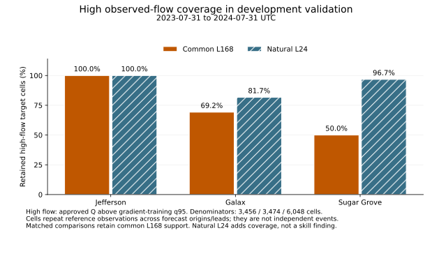
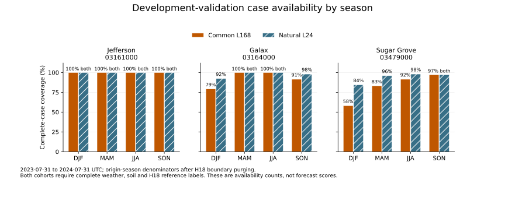

# Conditional training-core acceptance: checks before freeze

The user's November 2 reply accepts the recommended training core **subject to
these checks**. The 180-fit scope and $150 incremental ceiling remain confirmed.
No scientific comparison fit or protected assessment score has been produced.
The 2023–24 period remains development validation.

## Completed implementation and qualification

- **Temporal separation:** explicit role intervals remain distinct from refit
  availability. The optional, tested predicate is `last_target + 2h <= refit_B`
  for gradient-fit and inner-stop rows, never outer rows. Strict target-window
  purging still applies. For the proposed annual folds the earlier May 1 fit
  cutoff removes 18 final origins, while the July 31 inner-stop cutoff removes
  19 under the two-hour convention. This does not reconstruct historical USGS
  revisions or simulate fitting time.
- **Scaling:** only gradient-fit indices determine the saved affine statistics.
  Synthetic tests mutate stopping, outer and unassigned values/masks and verify
  unchanged fit statistics. Diagnostic flow-regime quantiles are separately
  identified; they are not model scalers.
- **Best-state inference:** the label-free API authenticates checkpoint/source/
  cohort identities and saved transforms, replays the stopping decisions, and
  loads `best_model` only. The bounded four-path synthetic integration passed
  eight updates with exact fresh-process physical predictions and no inference
  label access, optimizer construction or scaler fitting. One actual fixture
  selected epoch 1 while last weights were from epoch 2. This is engineering
  qualification, not forecast-skill evidence.
- **Scoring:** tested equal means over all 18 leads, all three CV folds and all
  three final-development seeds; no omitted bad fold or favorable seed. Missing
  predictions fail, undefined NSE propagates, and exact configuration ties use
  a declared order. Primary support is proposed at 168 distinct target hours
  across 28 UTC dates per lead, plus positive reference variance. This is a
  reporting floor, not proof of independence or power. Raw per-lead descriptive
  metrics remain visible below that floor.

Training and the early-stopping monitor use **standardized-Q MSE**. With a fixed
saved target scale s and identical cells, physical-unit MSE is `s² × MSE_std`
(up to floating-point rounding).
This identity cannot be applied to an average across different gauge/fold scales
using one common s. Reporting uses raw inverse-transformed flow in m³/s: physical
MSE, RMSE, MAE, bias, per-lead NSE and negative-prediction frequency. Inner-stop
MSE and outer equal-lead NSE are deliberately distinct selection criteria.
The current checkpoint policy uses strict loss improvement, patience 5 and a
minimum 10 training epochs under the 50-epoch cap; an earlier best epoch is
retained, exact ties do not replace it, and outer scores never choose an epoch.

## Exact temporal roles under review

All intervals are UTC and half-open. Every fold is an independent refit, with
new optimizer and gradient-only transformations. Its selected checkpoint is
fixed throughout the outer year; hourly rolling forecasts do not imply hourly
refitting. Final-development weights are not automatically retrained on 2023–24.

| Fit | Gradient-training interval | Inner stopping | Outer development scoring |
|---|---|---|---|
| CV1 | 2018-07-12 → 2020-05-01 | 2020-05-01 → 2020-07-31 | 2020-07-31 → 2021-07-31 |
| CV2 | 2018-07-12 → 2021-05-01 | 2021-05-01 → 2021-07-31 | 2021-07-31 → 2022-07-31 |
| CV3 | 2018-07-12 → 2022-05-01 | 2022-05-01 → 2022-07-31 | 2022-07-31 → 2023-07-31 |
| Final | 2018-07-12 → 2023-05-01 | 2023-05-01 → 2023-07-31 | 2023-07-31 → 2024-07-31 |

For refit B at the outer start, the two-hour availability predicate allows the
last inner origin at B−20h and last label at B−2h. The outer end retains the
strict target boundary: last origin end−19h, last label end−1h. These rules are
evaluated on actual timestamps, not the first surviving observed row. Excluded
boundary rows remain identified. The implementation does not imply that final
revised USGS observations were historically available at those simulated times.

## Material coverage result

The common L168 cohort has 146,464 development cases versus 153,216 naturally
complete L24 cases. Thus 6,752 L24 cases are deliberately excluded from matched
history comparisons. Coverage is not uniform by season: in validation, Sugar
Grove retains 1,269/2,184 winter origins under common L168 support, versus
1,845/2,184 naturally complete L24 origins.

For 2023–24 validation, HIGH means an approved reference value above the q95
threshold fitted only to that gauge's unique approved gradient-calendar hours.
The following are **origin/lead target cells**, with repeated observations across
forecast windows; they are not independent hours, events or forecast scores.

| Gauge | Approved HIGH target cells | Common L168 cells | Natural L24 cells | L24 cells lost by matching |
|---|---:|---:|---:|---:|
| Jefferson | 3,456 | 3,456 (100.0%) | 3,456 (100.0%) | 0 |
| Galax | 3,474 | 2,404 (69.2%) | 2,837 (81.7%) | 433 |
| Sugar Grove | 6,048 | 3,024 (50.0%) | 5,851 (96.7%) | 2,827 |

The fixed observed-peak rule identifies 9/6/11 validation events at Jefferson/
Galax/Sugar Grove. Respectively 0/1/3 observed peaks lack common forecast cases at
every lead, and another 0/1/1 lack them at some leads. The catalog retains these
events; no model errors were available to influence selection.

Across the full development reference calendar, the longest contiguous unusable
reference intervals are 430, 425 and 180 hours, respectively. These intervals
include absent exact-hour records and rejected estimated observations. They do
not establish station failure, and their hidden flow regimes/peaks are unknown.
No observation or target was filled.

**Tradeoff to resolve:** retain the requested complete-case L168 primary comparison
with explicitly conditional claims, or approve a separately specified admission/
outage sensitivity. The primary cannot establish high-flow performance during
excluded intervals, particularly at Sugar Grove. No primary cohort or 180-fit
matrix has been changed in response to this finding.

## Spatial and uncertainty holds

All three basins now reproduce their retained official USGS footprints and
weights after the separately approved exact Galax file was verified. The
original hold flags are unchanged. The known outlet/area case acceptances are
preserved; numerical validation is resolved, while the whole-study
approximate-footprint/non-nesting claim still needs its explicit scientific
interpretation. No surveyed/exact outlet or nested-conservation claim is made.
See `docs/spatial-support-audit.md` and the final full-v3 receipt.

The event and uncertainty specification is in
`docs/coverage-events-uncertainty.md`: fixed observed q95 peak selection without
model-error filtering; paired whole-origin vectors; proposed seasonal 14-day
moving blocks with 7/28-day sensitivities; no independent-hour or independent-seed
claim. One protected year cannot estimate between-year sampling uncertainty.
The conditional-interval interpretation and any confirmatory multiplicity or
practical-effect criterion remain material review items before freeze.

The full versus Q-only matrix tests weather plus soil **jointly**. It does not
separate either input contribution or establish standalone GRU/Mamba-2 component
advantages. NWM is external on genuinely matched forecasts; persistence remains
excluded. Primary output is unclipped. A zero-clipping sensitivity is not yet
adopted and cannot replace primary results or select a favorable checkpoint.

## Evidence

`reports/development-coverage-regimes-v2.json` preserves seasonal/regime counts,
unknown-reference intervals and the event catalog; v1 remains historical.
`reports/best-inference-qualification.json` records the executed synthetic check.
The scoring and temporal tests are source-controlled. These artifacts resolve
implementation checks; they do not override the remaining scientific holds or
the separate protected-assessment authorization gate.
