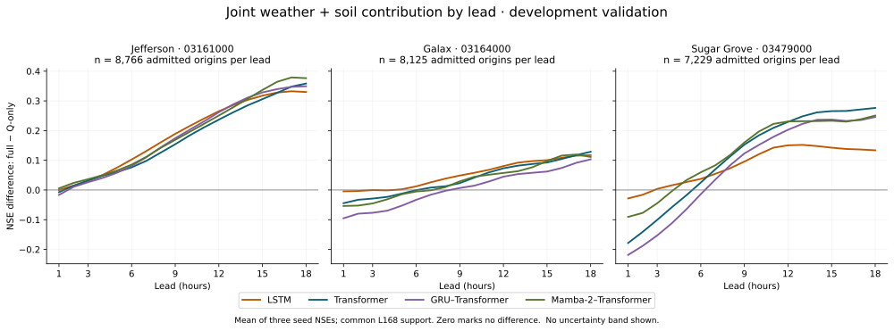
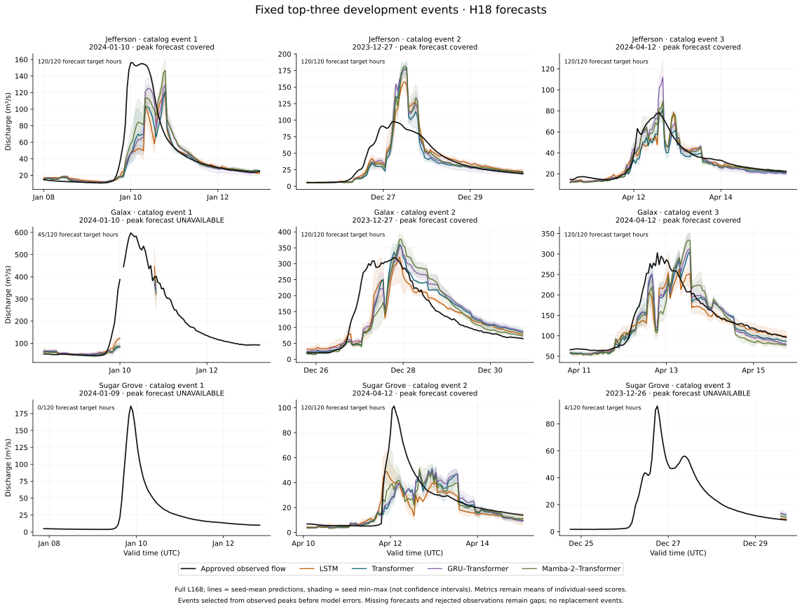
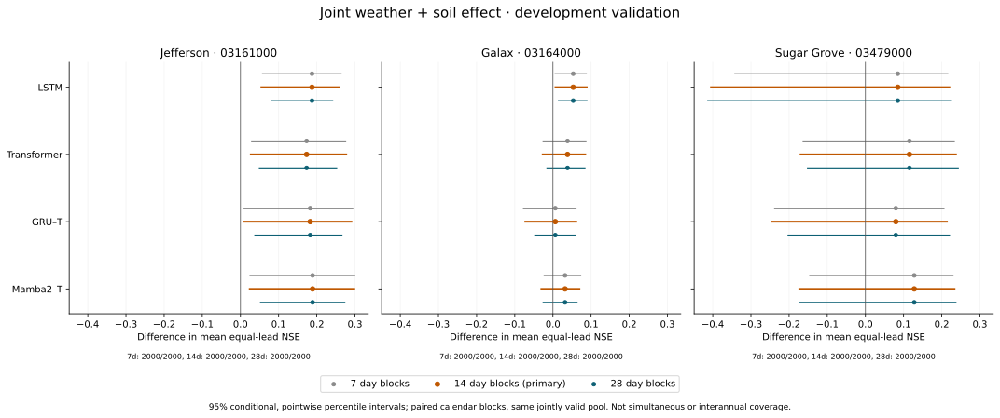

# DirectFlow development scientific review — November 5, 2026

**Ready for scientific review with material limitations.** The 180-fit campaign
and its predeclared development postprocessing are complete. These are
2020–24 development CV and 2023–24 final-development results. Protected
2024–25 assessment has not been opened or scored. No architecture is selected
as a universal winner, and no extra training or paid cloud job was started.

The [execution and results receipt](../reports/primary-development-postprocessing-v1.json)
and [independent final check](../reports/primary-postprocessing-final-check-v1.json)
record exact source/code/output identities. All 180 raw prediction sets reproduced
the recorded physical metrics and support counts; the largest absolute numerical
difference was 4.55e-13 against a fixed 1e-10 relative/absolute tolerance. All 216
primary contrast intervals and 3,240 per-lead intervals were independently
recomputed from saved draws using explicit sorted-order interpolation. Seven
figures were rendered and visually checked.

The older seed reports remain immutable and retain their publication-time
“postprocessing pending” labels. The new postprocessing release is the current
authority for completed event, uncertainty and residual analyses.

## What the current experiment supports

The full-input versus Q-only comparison measures weather **and soil together**.
Its final-development equal-lead mean NSE difference is positive in all 12
site/architecture comparisons. The primary conditional 14-day intervals exclude
zero for five: all four Jefferson comparisons and Galax LSTM. The same five
exclude zero under both 7- and 28-day sensitivities. This is a more qualified
finding than the positive point estimates alone.

| Gauge | Model | Full−Q mean NSE | 14-day percentile interval |
|---|---|---:|---:|
| Jefferson | LSTM | +0.1875 | [+0.0548, +0.2582] |
| Jefferson | Transformer | +0.1734 | [+0.0271, +0.2771] |
| Jefferson | GRU–Transformer | +0.1827 | [+0.0096, +0.2906] |
| Jefferson | Mamba-2–Transformer | +0.1890 | [+0.0243, +0.2980] |
| Galax | LSTM | +0.0531 | [+0.0067, +0.0885] |
| Galax | Transformer | +0.0383 | [-0.0268, +0.0847] |
| Galax | GRU–Transformer | +0.0062 | [-0.0724, +0.0611] |
| Galax | Mamba-2–Transformer | +0.0318 | [-0.0303, +0.0693] |
| Sugar Grove | LSTM | +0.0848 | [-0.4045, +0.2200] |
| Sugar Grove | Transformer | +0.1153 | [-0.1699, +0.2371] |
| Sugar Grove | GRU–Transformer | +0.0796 | [-0.2441, +0.2134] |
| Sugar Grove | Mamba-2–Transformer | +0.1279 | [-0.1731, +0.2334] |

These are conditional within-year, pointwise exploratory intervals, not
simultaneous family-wise coverage or calibrated forecast prediction intervals.
The residual-dependence concern below applies to their interpretation. All six
block-length × CV/final families retained 2,000/2,000 jointly valid draws;
zero invalid draws establishes computational support, not statistical independence.
All 12 CV full/Q intervals are positive at all three lengths, but the annual
folds have overlapping training histories and are not independent model replications.

The lead pattern is substantive: full-input H1 point NSE is lower in 11/12
comparisons, while H18 is higher in 12/12. The graph shows point differences;
separate panel bands are not paired per-lead contrast intervals. Do not claim
that additional inputs improve every horizon.

The attention and hybrid hypotheses remain mixed or unresolved. LSTM has the
highest full-L168 point mean at Jefferson and Galax; Mamba-2–Transformer has the
highest at Sugar Grove. There is no consistent hybrid advantage across gauges
and development periods. This matrix does not isolate attention mechanisms,
standalone GRU or standalone Mamba-2 components. A shared hidden width does not
make parameter counts equal, and one fixed configuration does not establish
architecture-optimal performance.

Longer history has no uniform advantage on common L168 support. Sugar Grove
Mamba-2 has a positive L168−L24 point estimate, but its interval includes zero
under the primary 14-day and 28-day analyses. Galax LSTM modestly favors L168;
Galax GRU–Transformer favors L24. The matched comparison does not measure L24's
potential availability gain on its larger natural cohort.

## Coverage changes the scientific interpretation

Known high flow means Q exceeds the fixed gradient-calendar q95, not an official
flood stage. The columns below deliberately use different denominators.

| Gauge | Known high-flow origin/lead cells with saved forecasts | Unique high-flow target hours with any forecast | Catalog peaks with H1 forecast | With H18 forecast |
|---|---:|---:|---:|---:|
| Jefferson | 3,456/3,456 (100.0%) | 192/192 | 9/9 | 9/9 |
| Galax | 2,404/3,474 (69.2%) | 154/193 | 4/6 | 4/6 |
| Sugar Grove | 3,024/6,048 (50.0%) | 172/336 | 8/11 | 7/11 |

A forecast being available at a peak does not mean it was accurate. Catalog peaks
are defined diagnostic episodes, not proven independent floods. Input availability,
reference quality and the stricter complete-vector comparison remain separate in
the event/regime reports. Observations with unusable qualifiers remain gaps; no
high-flow magnitude or station damage is inferred in those gaps.

The largest catalogued Sugar Grove event has **no forecast at its observed peak
at any lead**. Across its 120-hour window, only three origin/lead cells spanning
two unique target hours have saved matched forecasts. Its third-ranked event also
has no peak forecast. Galax's largest event has peak forecasts only at H4–H5;
its H1 and H18 peak forecasts are unavailable. Those events remain visible rather
than being replaced with cases that look better.

Each colored hydrograph is a rolling-origin fixed-lead series, not one continuous
18-hour forecast trajectory. Lines show seed-mean forecasts and shading shows
seed min–max, solely for display. Performance metrics remain means of the three
individual-seed metrics. Missing forecasts and rejected reference hours break
the lines. Event timing/amplitude errors remain visible even where annual NSE
is comparatively high.

## Residual-dependence review before assessment

Across final full-L168 model/seed/lead series, residual correlations remain at
multi-week lags, especially at Galax. Each row summarizes 216 series, not 216
independent statistical tests.

| Gauge | Lag (days) | Median absolute r | 90th percentile | Maximum |
|---|---:|---:|---:|---:|
| Jefferson | 7 | 0.030 | 0.049 | 0.059 |
| Jefferson | 14 | 0.081 | 0.181 | 0.235 |
| Jefferson | 28 | 0.009 | 0.025 | 0.052 |
| Galax | 7 | 0.141 | 0.315 | 0.392 |
| Galax | 14 | 0.173 | 0.336 | 0.420 |
| Galax | 28 | 0.150 | 0.285 | 0.354 |
| Sugar Grove | 7 | 0.088 | 0.171 | 0.284 |
| Sugar Grove | 14 | 0.074 | 0.142 | 0.236 |
| Sugar Grove | 28 | 0.064 | 0.129 | 0.237 |

Galax's maximum is GRU–Transformer, seed 17, H3: r=0.420 at 14 days and r=0.354
at 28 days; the other GRU seeds also retain long-lag dependence. This does not
by itself prove that season-stratified resampling is invalid: annual correlation
can include seasonal structure, and this diagnostic is not a within-season
stationarity test. It does mean that a claim that 14 days removes dependence
would be unsupported. Review the within-season/stationarity implications before
protected assessment. Keep all predeclared sensitivities; do not select the
length that produces favorable intervals.

The intervals must retain this residual-dependence qualification whenever shared
or placed on the poster. Their nominal percentile level is not an empirically
established coverage guarantee.

## Measured local workflow cost

These are mean elapsed times over the three final-development full-L168 fits.
They include loading, training, inner validation, prediction and scoring. They
are useful workflow costs, not isolated training/inference or universal hardware
benchmarks. CPU/MPS choices followed prior engineering timings. Mamba-2 used the
qualified local math implementation; fused CUDA performance was not tested.

| Gauge | Model | Backend | Parameters | Mean workflow minutes per seed |
|---|---|---|---:|---:|
| Jefferson | LSTM | CPU | 67,905 | 6.5 |
| Jefferson | Transformer | MPS | 85,057 | 19.1 |
| Jefferson | GRU–Transformer | CPU | 76,545 | 7.4 |
| Jefferson | Mamba-2–Transformer | MPS | 86,093 | 28.4 |
| Galax | LSTM | CPU | 67,905 | 4.7 |
| Galax | Transformer | MPS | 85,057 | 14.2 |
| Galax | GRU–Transformer | CPU | 76,545 | 6.4 |
| Galax | Mamba-2–Transformer | MPS | 86,093 | 17.8 |
| Sugar Grove | LSTM | CPU | 67,905 | 7.3 |
| Sugar Grove | Transformer | MPS | 85,057 | 15.4 |
| Sugar Grove | GRU–Transformer | CPU | 76,545 | 6.8 |
| Sugar Grove | Mamba-2–Transformer | MPS | 86,093 | 23.9 |

The complete 180-fit campaign took 38.13 elapsed hours, including the recorded
monitoring-recovery gap. Early stopping ended fits at 10–37 epochs; no fit reached
100. All seeds, raw negative predictions, original stopping decisions and prior
charges remain preserved. Per-lead physical errors and negative-prediction
frequencies remain in the full seed reports; no clipping sensitivity replaced
the primary scores.

## Figures and next review decisions

The [figure package](../figures/development-results-v1/README.md) contains seven
SVG exports with local PNG previews: NSE by lead, joint-input differences, all three block sensitivities
for input/history/architecture contrasts, and fixed H1/H18 representative events.
The existing protocol's approximate basin footprints, two-hour simulated
availability assumption and revised-observation vintage limitation still apply.
NWM remains a separately qualified external comparator; these results do not
establish an NWM comparison or operational reliability.

Before protected assessment, review residual dependence in the context of the
seasonal bootstrap, finalize the model/weight-selection record, and obtain the
separate explicit assessment authorization. Coverage limits already accepted
for the strict primary comparison must remain prominent; they are not grounds
to silently repair histories, fill targets or retrain after seeing results.

For the November 6 target, the defensible draft path is a **development-results
poster** with these caveats. Reconcile the accepted abstract with the HRRR
DirectFlow framing and Dr. Javidian's guidance, and use the existing AGU layout.
Older NWM/ERA5 results must not be presented as findings from this experiment.
