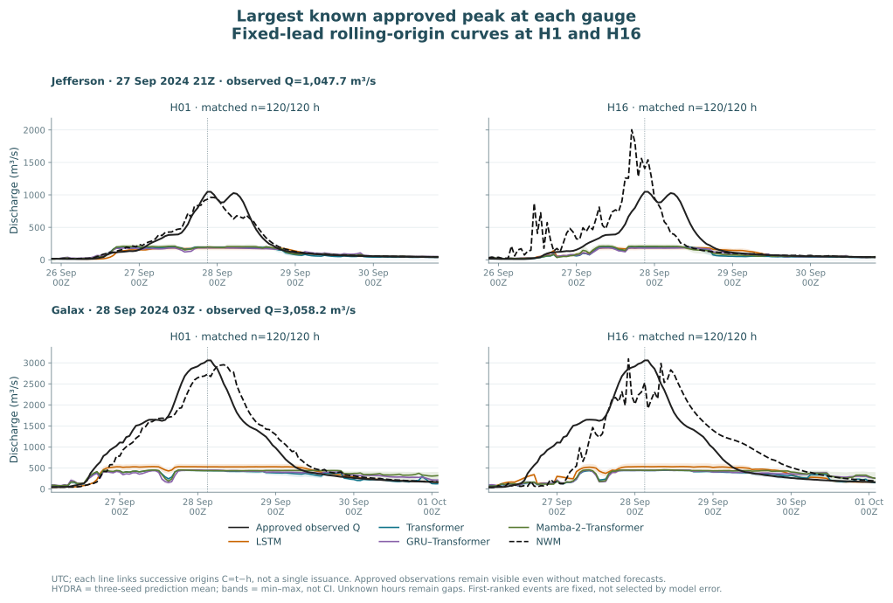

# Why NWM outperformed the saved models at Jefferson and Galax

The largest September 2024 peak windows dominate the annual matched NSE gap.
The saved neural models severely attenuate these peaks, and a parameter audit
identifies a binding limitation: their terminal LayerNorm, linear head and fixed
physical-flow inverse transformation impose output envelopes far below the
observed peaks. This is an identified constraint of these fixed checkpoints,
not proof that one architecture family is universally unsuitable.

No models were retrained, tuned, constructed or run. Existing predictions,
approved observations and saved parameters were inspected locally. The
original assessment results and all three seeds remain unchanged.

Each line connects **fixed-lead forecasts from successive hourly origins**;
it is not one issued forecast trajectory. The shaded ranges span the three
seed predictions and are not confidence intervals. All displayed comparisons
use the same approved, admitted cases. NWM is available only at H1–16 under
the retained C−2 issue rule.

## Peak magnitude is the central failure

All discharge values below are m³/s. HYDRA H1 ranges are across the four
architecture-specific three-seed means, evaluated at the observed peak hour.

| Gauge and observed peak UTC | Observed Q | NWM H1 | HYDRA H1 means | Upper envelopes across 12 saved models |
|---|---:|---:|---:|---:|
| Jefferson, 2024-09-27 21:00 | 1,047.7 | 932.4 | 184.3–196.8 | 153.0–247.4 |
| Galax, 2024-09-28 03:00 | 3,058.2 | 2,729.2 | 434.7–525.3 | 457.6–620.7 |

The largest observed peak exceeds the upper envelope of **every** corresponding
saved model. At H1, the most recent admissible discharge input was already
801.4 m³/s at Jefferson and 2,916.6 m³/s at Galax. Those readings occurred three
hours before the target peak: C=peak−1h and the last input is C−2h. Under the
study's simulated availability convention, observation delay alone therefore
does not explain predictions around 190 or 500 m³/s.

Over the full 120-hour largest-event windows, H1 NWM RMSE is 79.3 m³/s at
Jefferson versus 297.9–306.2 across HYDRA family means. At Galax it is 255.7
versus 997.0–1,066.7. NWM is not uniformly accurate: at Jefferson it increasingly
overpredicts the observed peak at longer leads, and its H16 trace contains large
errors. The lead plots retain those failures rather than presenting only its
best horizon.

| Detailed figures | Jefferson | Galax |
|---|---|---|
| All three selected event hydrographs, H1/H6/H12/H16 | [Hydrographs](figures/03161000_EVENT_HYDROGRAPHS.svg) | [Hydrographs](figures/03164000_EVENT_HYDROGRAPHS.svg) |
| H1–16 event RMSE and error at the observed peak | [Lead errors](figures/03161000_EVENT_LEAD_ERRORS.svg) | [Lead errors](figures/03164000_EVENT_LEAD_ERRORS.svg) |
| Annual NSE-gap accounting | [Contributions](figures/03161000_ANNUAL_NSE_GAP_DECOMPOSITION.svg) | [Contributions](figures/03164000_ANNUAL_NSE_GAP_DECOMPOSITION.svg) |

## The annual comparison is concentrated in one extreme episode

For each seed and lead, the difference is computed on the original annual
matched support as `(SSE_HYDRA − SSE_NWM) / SST_observed`. We partition its
numerator into the three nonoverlapping selected windows and the remaining
hours, then average the contributions over all 16 leads and all three seeds.
The pieces exactly reproduce the published equal-lead NSE difference.

| Gauge | Largest September window's signed share of the annual NWM advantage, across four families |
|---|---:|
| Jefferson | 103.78–104.16% |
| Galax | 99.15–101.51% |

A share above 100% means other periods partly offset the September deficit;
it is not a probability, independent discovery, or causal attribution. This
does not justify deleting the extreme event. It shows why the inability to
represent it matters so much to the annual squared-error/NSE result. The two
smaller selected events have more mixed relative performance.

## What the parameter check establishes

All four model families end in `Linear(LayerNorm(hidden))`, followed by the
saved affine inverse to physical flow. Let `w,b` be the linear-head parameters,
`gamma,beta` the LayerNorm parameters, and `d=64`. Define

`a=w*gamma`, `c=b+w·beta`, `R=sqrt(d)*||a−mean(a)||₂`.

In exact arithmetic, the standardized output lies in `[c−R,c+R]`: the vector
before LayerNorm's learned affine step has zero mean and norm at most `sqrt(d)`.
The saved positive target scale and mean map that interval into physical units.
The [pinned PyTorch LayerNorm definition](https://docs.pytorch.org/docs/2.8/generated/torch.nn.LayerNorm.html)
supports this derivation. All 24 checkpoints and all 3,578,040 corresponding
saved forecast values passed the envelope check, using a separately stated
floating-point comparison allowance.

These are **fixed learned-parameter envelopes**, not training-data maxima,
prediction intervals, or guarantees that the decoder can attain the endpoints.
Newly trained weights can change the envelope. Its presence establishes an
unavoidable peak-magnitude deficit for these checkpoints; it does not establish
why training produced those weights or attribute every timing/forcing error
to LayerNorm. Removing the final norm alone also need not remove amplitude
constraints elsewhere in a recurrent decoder.

## Selection, support and scientific limits

This is a post-assessment diagnostic, recorded before inspecting event-level
errors. The two gauges were requested because their annual results favored NWM.
Within each gauge, selection uses approved observations only: Q greater than
the previously frozen gradient-calendar q95, descending Q with earliest-UTC
ties, peaks separated by at least 168 hours, and the first three retained.
Windows are `[peak−48h, peak+72h)`, clipped to the full verification calendar,
including the H18 tail. No event was replaced using forecast availability or
error. They are diagnostic episodes, not proven independent floods.

Selected peaks:

| Gauge | Rank 1 | Rank 2 | Rank 3 |
|---|---|---|---|
| Jefferson | 2024-09-27 21Z; 1,047.7 | 2025-05-13 19Z; 182.4 | 2024-12-30 06Z; 98.0 |
| Galax | 2024-09-28 03Z; 3,058.2 | 2025-05-13 21Z; 489.9 | 2025-02-14 04Z; 331.3 |

All six selected windows have 120/120 matched hours at every supported lead,
including their observed peaks. Missingness therefore does not account for the
differences within these windows. Unknown or rejected observations elsewhere
remain gaps; no missing peak was inferred. The exact existing A/A+R quality
rule, approximate basins, simulated two-hour observation availability and raw
unclipped predictions remain unchanged.

Metrics average individual-seed scores, not the error of the displayed mean
curve. Peak-hour error is distinct from a rolling trace's maximum/timing. No
formal confidence intervals, architecture intervention, new training or causal
experiment was performed. Independent checking covered 1,320 event metric
panels, 25,542 scalar comparisons, source identities, plot arrays and the annual
decomposition. The public JSON files preserve all three seeds; raw full-year
arrays, checkpoint weights and event-hour trace CSVs remain private.

## iTransformer and an iTransformer–GRU hybrid

Both are reasonable **future development candidates**, but the current evidence
does not establish that they are better suited. iTransformer attends across
variable tokens; our history has one physical series, Q, plus age metadata.
The issued-weather block and initial soil state require an explicit adaptation,
not an unchanged application of the original model. Its input-window inverse
normalization is also a separate design choice from its attention axis.

The first controlled question should be the output/normalization and amplitude
path. Encoder and GRU-decoder comparisons should then hold that choice and
available information comparable. A GRU decoder is a new hypothesis, and its
bounded hidden state does not automatically solve peak representation.
See the [primary-source development proposal](../../docs/itransformer-development-proposal.md).
Any future fitting/tuning belongs entirely in development. Since this assessment
has now informed new research questions, it cannot be presented as an untouched
confirmatory test of those new choices.
